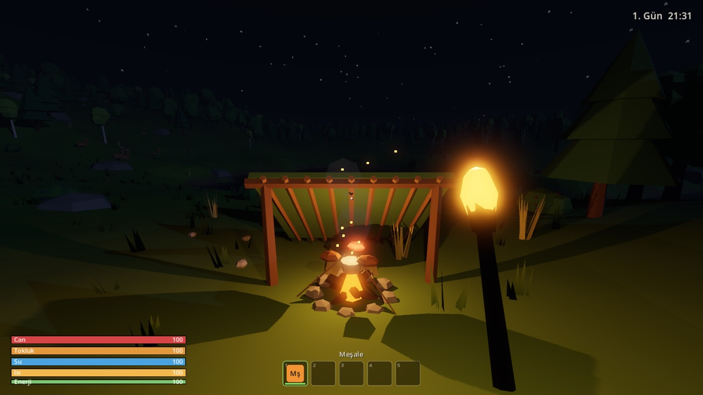
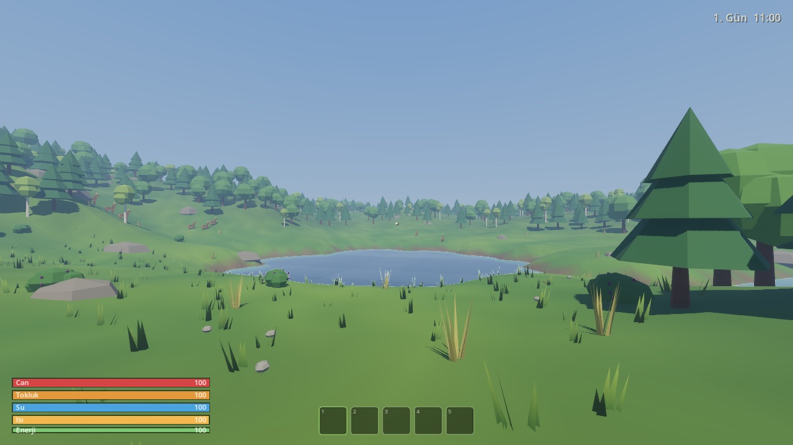
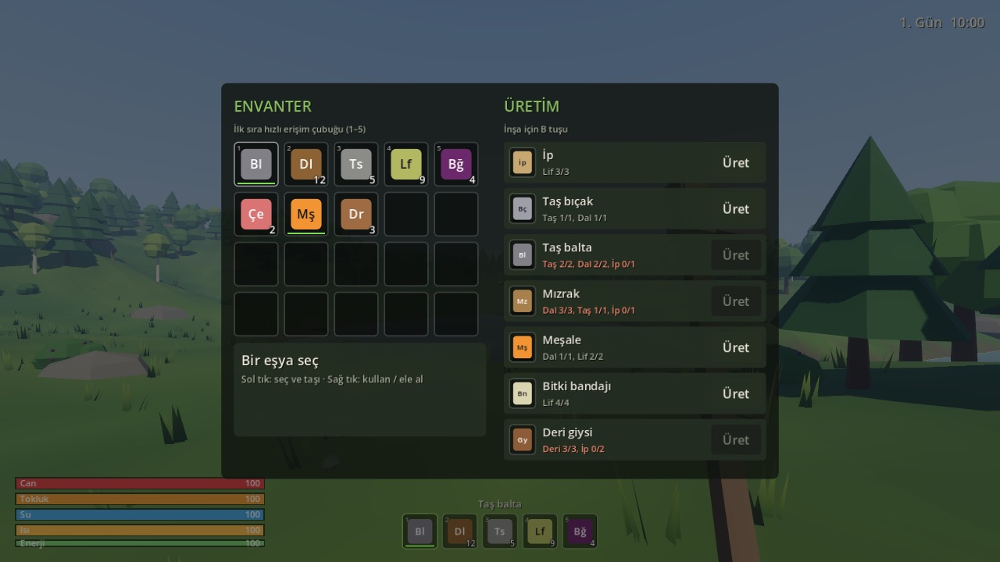
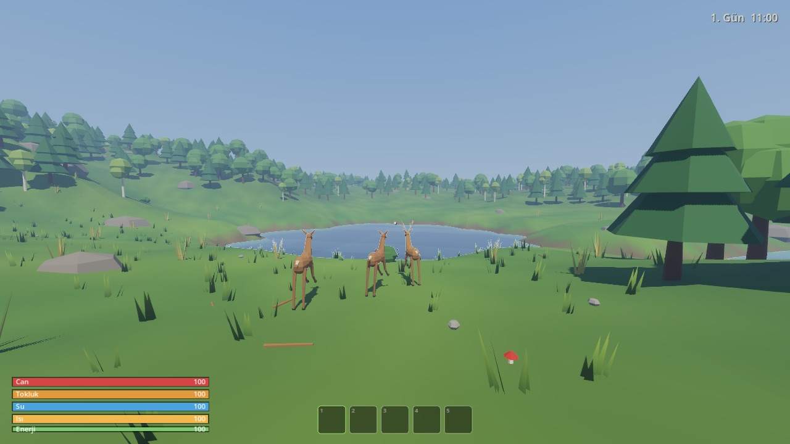
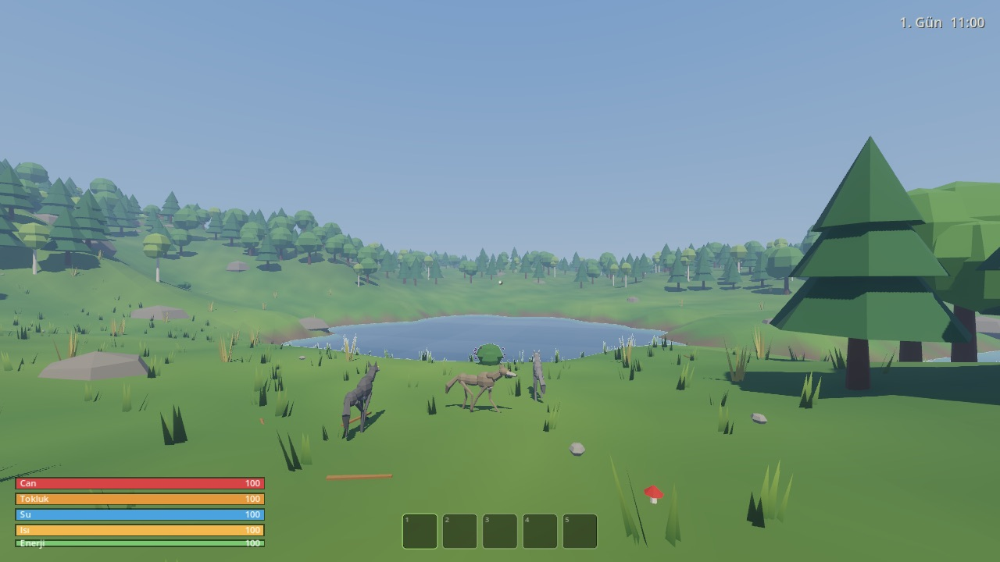
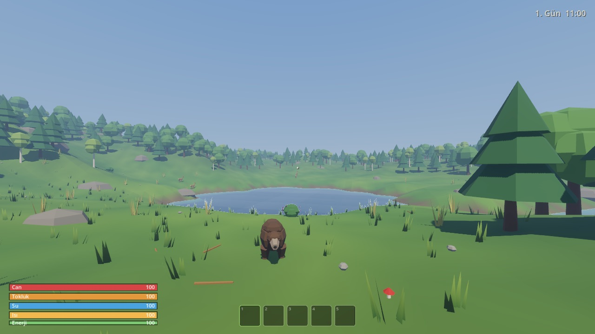
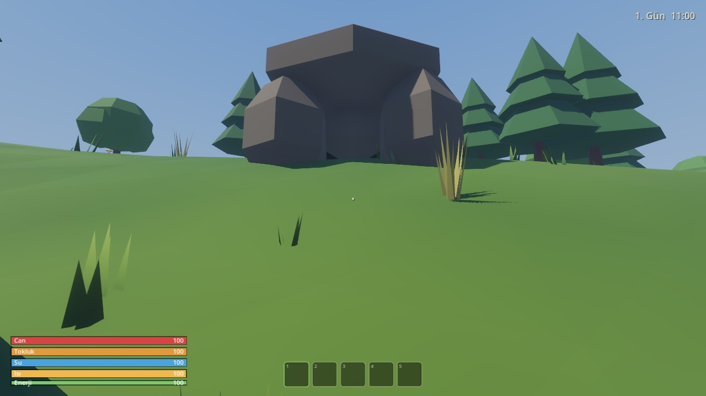
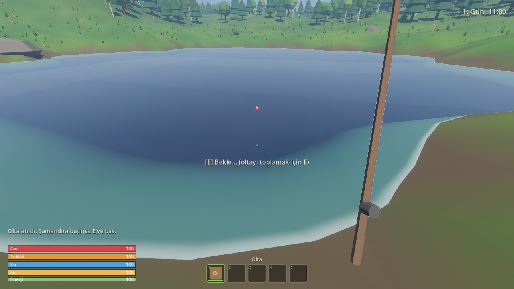
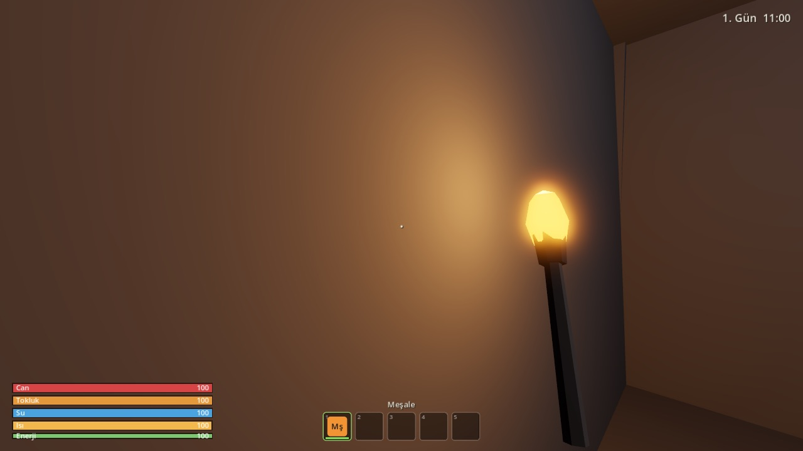

# ORMAN

Issız bir ormanda tek başına hayatta kalma oyunu. Birinci şahıs bakış, low-poly görünüm, [Godot 4](https://godotengine.org/) ile yapıldı.

The Forest'tan esinlendi ama **zombi, yamyam ya da gece saldırısı yok**. Tehlike doğadan geliyor: kurtlar, açlık, susuzluk, soğuk ve karanlık. Oyunun bir sonu yok; amaç olabildiğince çok gün hayatta kalmak.



| | |
|---|---|
|  |  |
|  |  |
|  |  |
|  |  |

## Özellikler

- **Prosedürel ada:** Her yeni oyunda tohumdan üretilen ada geliyor. Üzerinde düzensiz kıyılı bir göl, denize akan kıvrımlı bir dere, yaklaşık 3.500 ağaçlık orman, kayalar ve açıklıklar var.
- **Gece ve gündüz:** 16 dakika gündüz, 8 dakika gece sürüyor. Gece karanlık ve soğuk geçiyor, kurtlar daha cesur oluyor. Gökyüzünde güneş, ay ve yıldızlar var.
- **Hayatta kalma değerleri:**
  - Can, tokluk, su, vücut ısısı ve dayanıklılık takip ediliyor.
  - Çiğ et, kaynatılmamış su ve kırmızı mantar mide bulantısı yapabiliyor.
  - Suda dayanıklılık biterse boğuluyorsun.
- **Toplama ve üretim:**
  - Yerde dal ve taş, uzun otlarda lif, çalılarda böğürtlen, ormanda mantar bulunuyor. Toplananlar birkaç gün sonra yeniden çıkıyor.
  - E basıldığı anda çalışıyor; yerdeki eşyalara tam nişan almak gerekmiyor. E basılı tutulunca art arda toplanıyor.
  - Büyük kayalar baltayla kırılıp taş veriyor.
  - Üretilebilenler: ip, taş bıçak, taş balta, mızrak, meşale, bitki bandajı, deri giysi ve olta.
- **Ağaç kesme:** Baltayla kesilen ağaç devriliyor, geriye kütük ve dal bırakıyor.
- **Kamp ateşi:**
  - Yakıtla yanıyor; ışık ve ısı veriyor, kurtları uzak tutuyor.
  - Üstünde üç pişirme yeri var. Et pişiyor; fazla beklersen yanıyor.
  - Metal kapla su kaynatılıyor.
- **İnşa:** Yeşil/kırmızı önizlemeyle kamp ateşi, dal barınak ve saklama sandığı kurulabiliyor. Barınakta gece uyuyup sabaha atlanıyor, gündüz dinlenip kaydediliyor.
- **Hayvanlar:** Hepsi iki eklemli bacaklı, kaslı low-poly modellerle çiziliyor; engellerin etrafından dolaşıyorlar.
  - **Geyik:** Sürüyle otluyor. Fark edince başını kaldırıp bakıyor, yaklaşınca sekerek ve zikzak çizerek kaçıyor; sürü aynı yöne kaçıyor, güvenli mesafede durup geri bakıyor.
  - **Tavşan:** Açıklıklarda otluyor, keskin zikzaklarla kaçıp saklanıyor.
  - **Kurt:** Zayıf ve uzun bacaklı. Sürüyle önce etrafında dönüyor, sonra saldırıyor; ısırıp geri çekiliyor. Ateşin çevresine girmiyor, meşaleye mesafe koruyor, yaralanınca kaçıyor.
  - **Ayı:** Sık ormanda ve mağarada yaşıyor. Arka ayakları üstüne kalkıp kükreyerek uyarıyor; uzaklaşırsan bırakıyor, yaklaşırsan saldırıyor. Koşarak kaçılamıyor, ateşe yaklaşmıyor.
  - **Yılan:** Otlarda ve mağaralarda kıvrılıp yatıyor; çok yaklaşınca tıslıyor, sonra zehirli ısırıyor.
  - **Kuşlar:** Yerde gagalıyor, yaklaşınca havalanıp başka yere konuyor; kıyıda martılar dönüyor.
  - Leşi bıçakla kesince et ve deri alınıyor. Mızrak fırlatılabiliyor.
- **Balıklar:** Gölde ve kıyıya yakın denizde balık sürüleri var. Mızrakla vurulan balık yüzeye çıkıyor. Oltayı suya atınca şamandıra batana kadar bekliyorsun, sonra E ile çekiyorsun; geç kalırsan balık kaçıyor.
- **Mağaralar:** Yamaçlardaki kaya kemerli ağızlardan giriliyor. İçerisi meşalesiz zifiri karanlık ama rüzgarsız ve ılık.
  - **Ayı ini:** Geniş bir odada uyuyan bir ayı ve eski bir kampçının erzakı var.
  - **Labirent:** İç içe tüneller; öbür ucu deniz kıyısındaki ikinci bir ağızdan çıkıyor.
  - **Yılan mağarası:** Küçük, içinde yılanlar ve biraz ganimet var.
- **Kayıt:** Uyuyunca, duraklatma menüsünden ya da F5 ile kaydediliyor. Kesilen ağaçlar, yapılar, yerdeki eşyalar, hayvanlar ve leşler de kayda giriyor.
- **Ses:** Rüzgar, kuşlar, cırcır böcekleri, uzaktan kurt ulumaları, ateş çıtırtısı, ayak sesleri ve balta darbeleri var. Sesler `tools/gen_sfx.gd` ile prosedürel üretiliyor.
- **Arayüz:** Türkçe. Yeni oyuncuya bağlama göre ipucu veriyor, klavye/fare ve gamepad'i destekliyor.

## Kurulum ve çalıştırma

Gereken tek şey [Godot 4.7.2](https://godotengine.org/download/). macOS'ta Homebrew ile kurulabilir:

```bash
brew install --cask godot
```

Oyunu çalıştırmak için:

```bash
godot --path .
```

Editörde açmak için:

```bash
godot --editor --path .
```

## Kontroller

| Eylem | Klavye / fare | Gamepad |
|---|---|---|
| Hareket | WASD | Sol çubuk |
| Bakış | Fare | Sağ çubuk |
| Koşma | Shift | Sol çubuğa bas |
| Zıplama | Space | A |
| Eğilme | Ctrl / C | Sağ çubuğa bas |
| Etkileşim / topla (basılı tutunca art arda) | E | X |
| Vur / ye / kullan | Sol tık | RT |
| Mızrak fırlat / inşayı iptal et | Sağ tık | LT |
| Envanter ve üretim | Tab / I | Y |
| İnşa menüsü | B | D-pad yukarı |
| İnşada döndür | R | D-pad sağ |
| Hızlı erişim | 1–5, fare tekerleği | LB / RB |
| Hızlı kayıt | F5 | Back |
| Duraklatma menüsü | Esc | Start |

## Nasıl hayatta kalınır

1. Başladığın yerin yakınında terk edilmiş bir kamp var. Oradaki **metal kabı** ve **matarayı** al.
2. Etraftan dal, taş ve uzun otlardan lif topla. Tab ile envanteri açıp önce **ip**, sonra **taş balta** yap.
3. Göl ya da dereye bakıp E'yi basılı tutarak su iç. Deniz suyu tuzlu, susuzluğunu artırır.
4. Hava kararmadan **kamp ateşi** kur (B) ya da **meşale** yap. Gece açıkta kalırsan donarsın.
5. Geyiğe eğilerek yaklaş. Mızrakla vur ya da sağ tıkla fırlat. Leşi **taş bıçakla** kes.
6. Çiğ eti ateşte pişir, ham suyu metal kapla kaynat.
7. Kütükleri topla, **dal barınak** kur. Gece uyuyup sabaha atla; oyun kaydedilir.
8. Kurtlar gelince ateşin yanında kal ya da meşaleyi elinde tut. Ayıdan koşarak kaçamazsın: kükrerse yavaşça uzaklaş.
9. Balık için mızrak ya da olta kullan; balığı da ateşte pişir.
10. Mağaralara meşalesiz girme. Ayı inindeki erzak değerli ama ayıyı uyandırma.

## Tarifler

| Üretim | Malzemeler |
|---|---|
| İp | 3 lif |
| Taş bıçak | 1 taş, 1 dal |
| Taş balta | 2 taş, 2 dal, 1 ip |
| Mızrak | 3 dal, 1 taş, 1 ip |
| Meşale | 1 dal, 2 lif |
| Bitki bandajı | 4 lif |
| Deri giysi | 3 deri, 2 ip |
| Olta | 2 dal, 1 ip |
| **Kamp ateşi** (inşa) | 4 taş, 4 dal |
| **Dal barınak** (inşa) | 4 kütük, 10 dal, 2 ip |
| **Saklama sandığı** (inşa) | 3 kütük, 1 ip |

Eşyalar `data/items/`, tarifler `data/recipes/` altında `.tres` dosyalarıdır. Yeni eşya ya da tarif eklemek için kod değişikliği gerekmez.

## Geliştirme

### Proje yapısı

| Klasör | İçerik |
|---|---|
| `autoload/` | Her yerden erişilen sistemler: girdi, saat, kayıt, eşya veritabanı, ses, denge |
| `data/` | Eşya ve tarif `.tres` dosyaları, denge ayarları (`balance.tres`) |
| `world/` | Prosedürel ada, su, gökyüzü, ağaçlar, kaynaklar, ortam sesleri, ipuçları |
| `player/` | Hareket, hayatta kalma değerleri, envanter, etkileşim, eldeki eşya, inşa |
| `crafting/` | Eşya/tarif sınıfları, üretim ve pişirme mantığı |
| `buildables/` | Kamp ateşi, dal barınak, saklama sandığı |
| `animals/` | Ortak davranış makinesi, geyik, kurt, yerleştirme, dış model yükleyici |
| `ui/` | HUD, envanter, inşa, sandık, ana menü, duraklatma, ayarlar, ölüm ekranı |
| `tools/` | Test betiği, ses üretici, komut satırı ekran görüntüsü aracı |
| `tests/` | Birim ve entegrasyon testleri (GUT) |

### Testler

Birim ve entegrasyon testleri [GUT](https://github.com/bitwes/Gut) ile headless çalışır. Entegrasyon testleri dünyayı gerçekten yükler; toplama, ağaç kesme, pişirme, inşa, uyku, hayvan davranışı ve kayıt/yükleme akışlarını dener.

```bash
./tools/test.sh
```

### Denge ayarları

Bütün sayılar `data/balance_data.gd` içindedir. Değişiklikler editörde `data/balance.tres` üzerinden yapılır. Ayarlanabilenler: açlık/susuzluk hızları, gece süresi, ateş yakıtı, pişirme süreleri, kurt hasarı ve benzerleri.

### Sesleri yeniden üretmek

```bash
godot --headless --path . -s res://tools/gen_sfx.gd
```

### Komut satırından ekran görüntüsü

`tools/debug_capture.gd` dünyayı istenen saat ve konumda açar, ekran görüntüsünü kaydedip kapanır. Örnek:

```bash
godot --path . -- --seed=42 --time=21.5 --campfire=cook --give=torch:1 --shot=/tmp/gece.png
```

Diğer argümanlar: `--pos=x,z`, `--height=m`, `--yaw`, `--pitch`, `--atlake`, `--stats=can,tokluk,su,ısı`, `--animal=wolf:3` (deer, rabbit, bear, snake), `--place=shelter`, `--ghost=campfire`, `--fishing`, `--mouth=0`, `--cave=0`, `--inventory`, `--pause`, `--menu`, `--fpsprobe`.

### Gerçek hayvan modelleri (isteğe bağlı)

Oyun, tamamı koddan üretilen yer tutucu low-poly modellerle çalışır. `assets/models/animals/` klasörüne Quaternius *Ultimate Animated Animals* paketinden (CC0) `Deer.gltf`, `Stag.gltf` ve `Wolf.gltf` dosyalarını (ayı için `Bear.gltf`) koyarsan oyun otomatik olarak bunları kullanır. Animasyonlar isimlerinden eşlenir. Ayrıntılar için [assets/models/animals/README.md](assets/models/animals/README.md) dosyasına bak.

### Dışa aktarma (macOS / Windows)

`export_presets.cfg` içinde macOS ve Windows ayarları hazır. Önce Godot editöründe **Editor > Manage Export Templates > Download and Install** ile 4.7.2 şablonlarını kur, sonra:

```bash
godot --headless --path . --export-release "macOS" export/macos/Orman.zip
```

```bash
godot --headless --path . --export-release "Windows Desktop" export/windows/Orman.exe
```

## Elle oynama kontrol listesi

- [ ] Göl bul ve su iç; deniz suyunun tuzlu olduğunu gör.
- [ ] Kamptan metal kabı ve matarayı al; matarayı doldur.
- [ ] Lif, dal ve taş toplayıp ip ve balta yap.
- [ ] Ağaç kes, kütükleri topla.
- [ ] Kamp ateşi kur, yakıt ekle, ateşin söndüğünü ve yeniden yandığını gör.
- [ ] Geyik avla, leşi bıçakla kes, eti pişir ve ye; bir eti yakmayı dene.
- [ ] Ham suyu kaynat.
- [ ] Barınak kur; gece uyu ve sabah oyunun kaydedildiğini gör.
- [ ] Gece kurtlardan ateş ya da meşaleyle korun.
- [ ] Tavşan ve geyiğin kaçışını izle; bir ayının uyarısını gör ve uzaklaş.
- [ ] Oltayla ve mızrakla balık tut, pişir.
- [ ] Meşaleyle bir mağaraya gir; labirentten kıyıya çık.
- [ ] Oyunu kaydet, ana menüye dön, "Devam et" ile yükle.
- [ ] Aç ya da susuz kalıp öl; ölüm ekranını ve rekoru gör.

## Lisanslar

Kod, ses ve yer tutucu modeller bu projeye aittir. Kullanılan araçlar ve isteğe bağlı paketler için [CREDITS.md](CREDITS.md) dosyasına bak.
